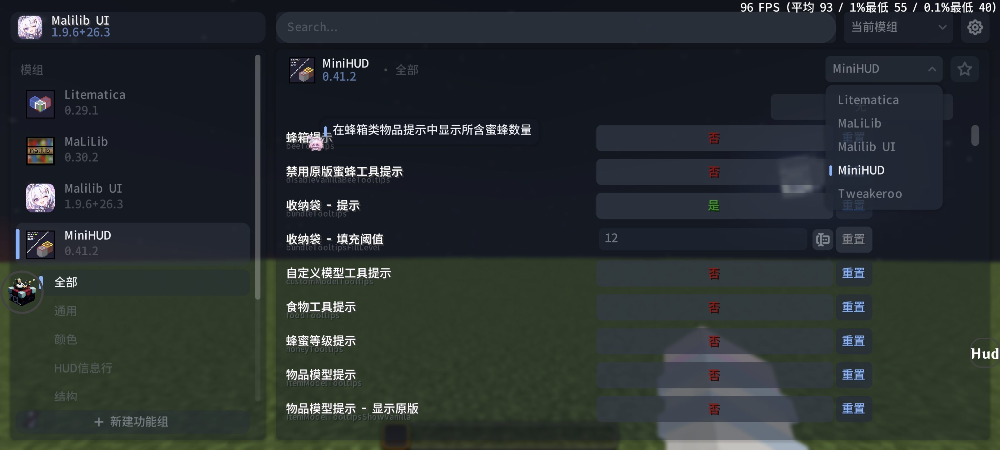

# Malilib UI

masa 系列模组（所有使用 **MaLiLib** 配置界面的模组：Litematica / MiniHUD / Tweakeroo / MaLiLib 本体…）的现代化配置界面。

半透明玻璃质感、左侧模组导航、跨模组搜索、一站式快捷开关。**不 fork malilib**，全部通过 Mixin 在运行时接管原界面与控制件样式。




---

## 功能

### 导航
- **左侧模组列表**：每个模组显示图标、名称、版本
- **功能页列表**：展开模组即可看到它的各个功能页（原 tab），点击直达
- **常用（置顶）**：把任意模组的任意功能置顶成一行，直接开关，无需进配置页
- **功能组**：把多个功能打包，一键全部开启 / 全部关闭（关闭时还原开启前的值）
- **三种滚动**：鼠标滚轮、拖动右侧滚动条、按住任意位置拖动（适配触屏）
- **拖拽排序**：模组（拖图标）、功能页（设置页）、常用项、功能组均可自定义顺序

### 搜索
- 顶部**常驻搜索框**，与右侧内容区对齐，输入即时过滤
- 范围可选「当前模组 / 全部模组」；全范围模式下左栏列出命中功能（中文名 + 英文原名双行），点击直接跳到对应模组并定位
- 同时匹配中文显示名、英文原名、模组名

### 外观
- **半透明**：面板 / 控件 / 遮罩**三层透明度分别可调**
- **颜色**：强调色（10 套预设 + 颜色选择器）、面板底色、文字颜色；面板底色可跟随强调色自动推导
- **圆角**：0~16 可调，弧边用运行时生成的抗锯齿遮罩贴图绘制（无阶梯锯齿）
- **侧栏宽度**：140~320 可调，布局实时重排
- **显示**：模组图标 / 背景模糊 / 紧凑模式开关
- 图标系统基于 **Tabler Icons**，支持运行时按状态染色

### 接管 malilib 控件
- 按钮、滑杆（含拖动）、下拉框、文本输入框、滚动条
- 悬停提示框（圆角卡片 + 自动换行 + 贴边翻转）
- 配置行：中文名下自动补一行英文原名（缩放绘制）
- 滑杆 / 输入框切换按钮换成统一图标

### 其他
- 配置改动**即时保存**（松手即落盘）
- 记住上次打开的模组与功能页
- **Mod Menu 集成**：每个 masa 模组条目都有齿轮入口
- 中文 / English 双语

---

## 已知问题

1. **功能收藏（置顶）还有问题** —— 置顶项的快捷开关与拖拽排序在部分场景下表现不稳定。
2. **功能分组 / 自定义功能组还有问题** —— 组的创建、成员维护与整组开关尚需打磨。

> 这两块功能目前可用但不完善，会在后续版本修复。

---

## 构建要求

| 项目 | 要求 |
|---|---|
| JDK | **25**（Minecraft 26.x 要求） |
| Gradle | **9.8.2**（或使用仓库自带 wrapper） |
| Minecraft | **26.3** |
| Fabric Loader | **0.20.1** |
| Fabric Loom | **1.19-SNAPSHOT** |
| 平台 | Fabric（客户端 mod） |

### 依赖 jar（不随仓库提供）

出于体积与授权考虑，以下 jar 需自行放入项目根目录的 `libs/`：

```
libs/
├── malilib-fabric-26.3-0.30.2.jar        # 必需：编译前置
├── litematica-fabric-26.3-0.29.1.jar     # 可选：开发期参考
├── minihud-fabric-26.3-0.41.2.jar        # 可选
├── tweakeroo-fabric-26.3-0.30.1.jar      # 可选
├── modmenu-21.0.0.jar                    # 可选（Mod Menu 集成，编译期）
└── Searchables-fabric-26.3-1.0.3.jar     # 可选（搜索增强，编译期）
```

### 命令

```bash
# 在线构建
./gradlew build

# 离线构建（依赖全部来自 libs/ 与本地 Gradle 缓存）
./gradlew --offline build
```

产物：`build/libs/malilib-ui-<version>.jar`

---

## 配置文件

```
.minecraft/config/malilib-ui/
├── settings.json   # 外观 / 显示 / 排序等配置
└── layout.json     # 自定义顺序 / 置顶列表 / 功能组 / 上次停留位置
```

两个文件即可完整备份或迁移界面布局。

---

## 致谢 / 许可

- 界面灵感与协议基础：[malilib](https://github.com/maruohon/malilib)（masa 系列）
- 图标：[Tabler Icons](https://github.com/tabler/tabler-icons)（MIT）
- 作者：**KangGust**
- 许可：**MIT**（见 [LICENSE](LICENSE)）
